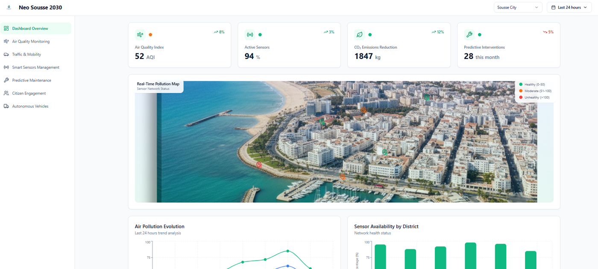
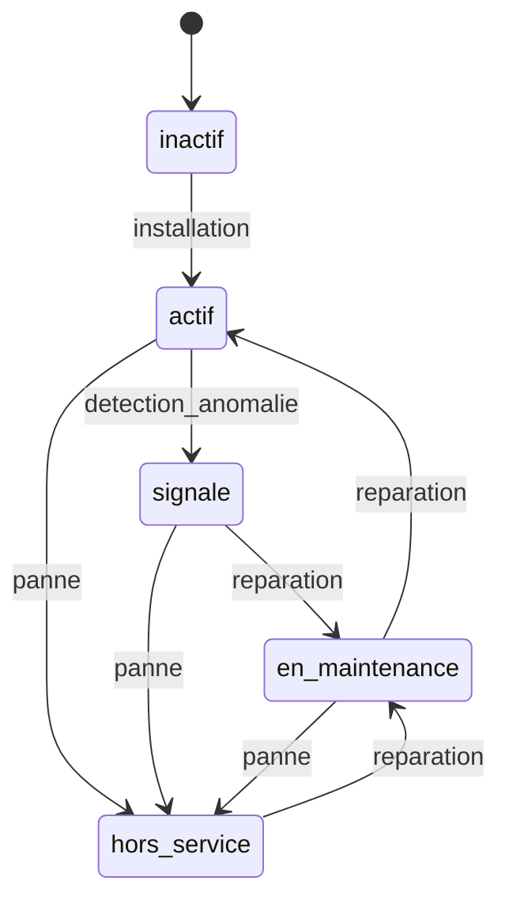
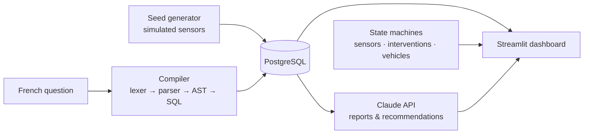
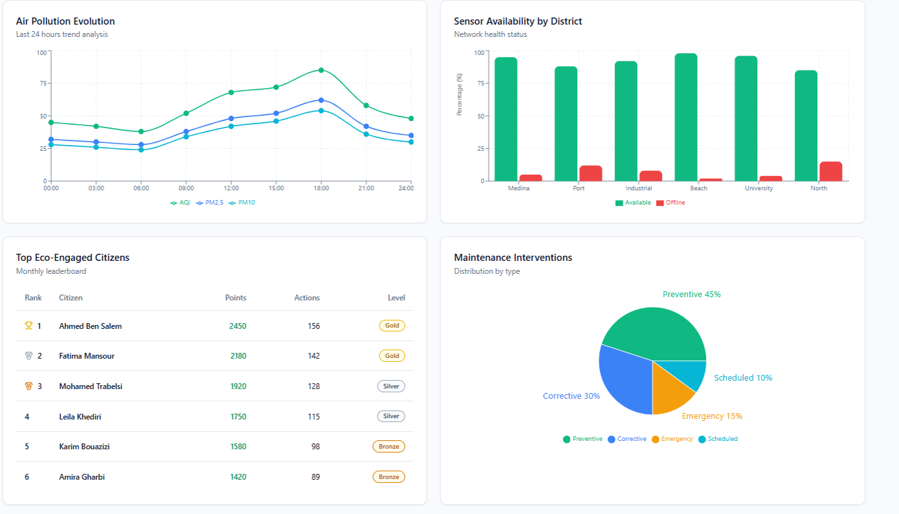
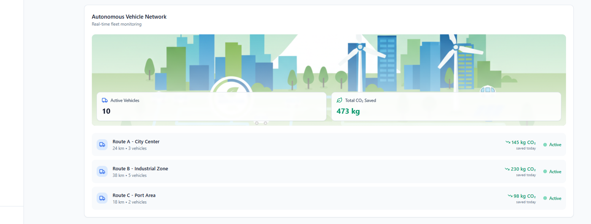
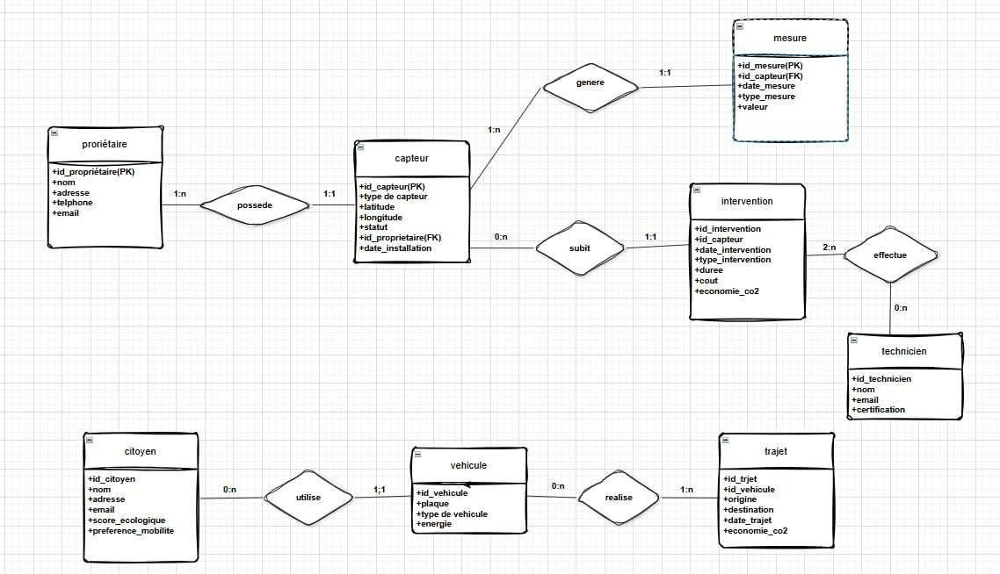

# Neo-Sousse 2030 — Smart City Analytics Platform

> A data platform for a fictional smart city: sensors stream urban data (air quality, traffic, energy, waste, lighting) into **PostgreSQL**, and managers can explore it on a dashboard, **ask questions in plain French that are compiled to SQL**, follow the life cycle of sensors and interventions with **finite state machines**, and get **AI-generated reports**.

Module project at **ENISo, National Engineering School of Sousse** (IA2, 2025–2026), **built entirely by me**, El Aziza Mariem Lanouar, over two modules (completed April 2026):
1. **Databases:** modelling the city's data and building the analytics dashboard (`semester1-database/`)
2. **Language Theory & Compilation + Generative AI:** the NL→SQL compiler, the automata and the AI reports (main app)

The city's data is **simulated**: a seed script generates realistic sensors, measurements, interventions, citizens and vehicles, so the platform behaves like it would with live sensors.



---

## Features

| Module | What it does |
|---|---|
| **Dashboard** (`frontend/app.py`, Streamlit) | City KPIs, pollution heatmap of Sousse (Folium), air-quality trends, sensor availability by district, data explorer |
| **NL → SQL compiler** (`compiler/`) | Turns French questions into SQL through a real compiler pipeline: **lexer → parser → AST → SQL generator** |
| **Finite state machines** (`automata/`) | 3 deterministic automata: sensor life cycle, intervention validation workflow, autonomous-vehicle trip. Invalid transitions are rejected and raise alerts |
| **AI reports** (`ai_module/`) | Claude API generates air-quality and sensor reports, prioritised recommendations, and checks automaton transitions |
| **Database** (`database/`) | PostgreSQL schema (zones, sensors, measurements, technicians, interventions, citizens, vehicles, trips), analytics views and a seed-data generator |

### NL → SQL examples

| Question (French) | Generated SQL |
|---|---|
| *Affiche les 5 zones les plus polluées* | `SELECT zone, pollution_moyenne, ... FROM v_zones_polluees ORDER BY pollution_moyenne DESC LIMIT 5;` |
| *Combien de capteurs sont hors service ?* | `SELECT COUNT(*) AS total FROM capteurs WHERE statut = 'hors_service';` |
| *Quels citoyens ont un score écologique > 80 ?* | `SELECT ... FROM citoyens WHERE score_ecolo > 80.0;` |
| *Donne-moi le trajet le plus économique en co2* | `SELECT ... FROM trajets ORDER BY economie_co2 DESC LIMIT 1;` |

Grammar (simplified BNF), from `compiler/nl_sql_compiler.py`:
```
query            ::= afficher_clause | compter_clause | donner_clause
afficher_clause  ::= ("affiche" | "montre" | "liste") [limit_clause] entity [condition_clause] [order_clause]
compter_clause   ::= ("combien" | "nombre") [de_clause] entity [condition_clause]
donner_clause    ::= ("donne" | "trouve") entity [condition_clause] [order_clause]
condition_clause ::= ("où" | "qui" | "avec" | "ayant" | "dont") field comparator value
order_clause     ::= ("classés" | "triés" | "ordonné") "par" field [("asc" | "desc")]
limit_clause     ::= "les" NUMBER ("plus" | "premiers" | "derniers")?
```

### Sensor life cycle (DFA)



## Architecture



## Screenshots

| Analytics | Autonomous vehicles |
|---|---|
|  |  |

Data model (entity–relationship diagram):



## Run it

```bash
pip install -r requirements.txt
cp .env.example .env        # then fill in your PostgreSQL password (and an Anthropic API key for AI reports)
bash start.sh               # creates the database, loads the schema and seed data, starts the dashboard
```

The dashboard opens at http://localhost:8501. Without a database it falls back to sample data, and without an API key the AI pages explain how to add one.

Run the test scenarios (compiler, automata, end-to-end):
```bash
python tests/test_scenarios.py
```

## Repository structure

```
├── compiler/nl_sql_compiler.py   # NL → SQL: lexer, parser, AST, SQL generator
├── automata/fsm_engine.py        # Sensor, intervention and vehicle state machines
├── ai_module/report_generator.py # AI reports with the Claude API
├── backend/database.py           # PostgreSQL access layer
├── database/                     # schema.sql (tables + views) and seed_data.py
├── frontend/app.py               # Streamlit dashboard
├── tests/test_scenarios.py       # 10 test scenarios
├── semester1-database/           # First module: schema, seed data and first dashboard
└── docs/                         # Screenshots, ER diagram, database report (FR)
```

## Tech stack

Python · PostgreSQL · Streamlit · Plotly · Folium · psycopg2 · Claude API (Anthropic)
